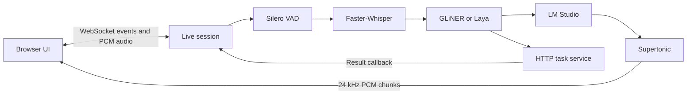

# OpenGPT-Voice

> **A local GPT-Live-style voice agent for real-time conversation—built around turn-taking, interruption, and speech-aware state.**

OpenGPT-Voice recreates the feeling of talking naturally to an AI while keeping the complete speech-and-reasoning pipeline visible and replaceable. A browser streams microphone audio to a local server, local models decide what happened and what should happen next, and generated speech is streamed back as PCM audio.

This is more than a chatbot with a microphone attached. It is a small playground for the difficult parts of realtime voice: conversation boundaries, barge-in, playback state, tool calls, background events, and keeping a session coherent when people pause, correct themselves, or interrupt.

> **Project status:** OpenGPT-Voice is an active proof of concept, not a production-ready assistant. It is designed for experimentation on one machine.
>
> **GPT-Live** refers to the event protocol this project is compatible with. OpenGPT-Voice is independent and is not affiliated with or endorsed by OpenAI.

## Contents

- [Why this project exists](#why-this-project-exists)
- [The problems it addresses](#the-problems-it-addresses)
- [What OpenGPT-Voice does today](#what-open-gpt-voice-does-today)
- [Who it is for](#who-it-is-for)
- [Use cases and scenarios](#use-cases-and-scenarios)
- [How it works](#how-it-works)
- [GPT-Live-compatible WebRTC and delegation layer](#gpt-live-compatible-webrtc-and-delegation-layer)
- [Quick start](#quick-start)
- [Configuration](#configuration)
- [Tools, background tasks, and API](#tools-background-tasks-and-api)
- [Privacy, offline use, and limitations](#privacy-offline-use-and-limitations)
- [Development](#development)
- [Project direction](#project-direction)
- [Contributing](#contributing)

## Why this project exists

The original motivation was simple:

> I like the GPT-Live-style experience, but why must it depend on a hosted realtime system? Why not build the loop locally, where I can inspect it, change it, and use it without sending every conversation to a remote inference provider?

A hosted voice experience often looks like this:

```text
microphone → hosted realtime API → speaker
```

That is convenient, but the interesting machinery is hidden inside the service. OpenGPT-Voice makes the loop explicit:

```text
microphone → VAD → ASR → routing → LLM → TTS → playback → conversation state
```

The goal is not to hide local models behind one opaque API. It is to make every stage available for experimentation:

- Run the core voice pipeline on your own hardware.
- Inspect where latency and errors occur.
- Swap models without rewriting session orchestration.
- Change routing, prompts, turn-taking, or tool behavior directly.
- Test interruptions and other difficult conversation cases that are hard to reproduce with a hosted demo.
- Avoid ongoing cloud-inference cost and keep core inference under your control.

## The problems it addresses

### 1. Hosted voice agents make local experimentation difficult

Many realtime voice products combine speech recognition, reasoning, tool use, and speech output behind a remote service. That can be useful, but it makes it difficult to answer questions such as:

- Where did the delay come from?
- What exactly did the user hear before interrupting?
- How should an unfinished response affect conversation history?
- Can a small local router avoid unnecessary LLM work?
- Can the assistant continue a conversation when the internet is unavailable?

OpenGPT-Voice keeps VAD, ASR, routing, LLM, and TTS as separate components. Once dependencies and models are available locally, the core conversation does not require cloud inference or a continuous internet connection.

**Local does not automatically mean private or secure.** It changes where inference runs, not whether the rest of the operating system, browser, network, tools, or external task services are trustworthy.

### 2. Real conversations are harder than `STT → LLM → TTS`

A basic voice chatbot can treat one user request as one complete turn. Human conversation is messier: people interrupt, pause, correct themselves, start a sentence and add another, or launch background work and continue talking.

| Realtime challenge | Why it matters | How OpenGPT-Voice approaches it |
| --- | --- | --- |
| **Turn boundaries** | Silence may mean “finished,” “thinking,” “correcting myself,” or “I’m waiting.” | Silero VAD detects speech boundaries, while the router can combine an incomplete turn with the next one. |
| **Barge-in** | New speech can make the active response stale. | The router can cancel the active LLM stream and queued/active assistant audio before handling the new intent. |
| **Generated text vs. heard text** | A model may generate hundreds of words while playback reaches only the first sentence. | The browser maps transcript segments to the playback timeline, and interrupted replies are not inserted as though they were fully heard. |
| **Incomplete requests** | “Remind me in…” may continue in the next utterance. | A `wait_for_user` routing decision holds the transcript instead of prematurely calling the LLM. |
| **Background events** | A timer or external task can finish while another reply is speaking. | Results can be spoken quietly, queued until playback finishes, prioritized after a sentence, or made to wait for user input. |
| **Unnecessary LLM calls** | Silences, incomplete turns, and task-only requests do not always need expensive reasoning. | A small GLiNER or Laya router makes lightweight decisions before LM Studio is called. |

These are implementation concerns, not just UI effects. They affect latency, memory, costs, safety, and whether the conversation state remains truthful.

## What OpenGPT-Voice does today

The current slice provides a working browser-to-server voice loop with:

- Local Silero VAD for speech-boundary detection.
- Local Faster-Whisper speech recognition.
- GLiNER2.5-Decide routing, with Laya as an optional multilingual router.
- Local conversational generation through LM Studio’s OpenAI-compatible API.
- Local Supertonic text-to-speech streamed as 24 kHz mono PCM16 audio.
- Sentence-level streaming, queued playback, pause/resume, and barge-in handling.
- Playback-aware transcript rendering in the browser.
- `get_current_time` and session-bound `start_timer` tools.
- Fire-and-forget task delegation over HTTP with callback delivery over WebSocket-style session events.
- A GPT-Live-compatible WebSocket event layer.
- Structured local JSON logs without raw audio or complete transcripts by default.
- A modular ports-and-adapters design so model implementations can be replaced independently.

It is not yet a turnkey local-computer assistant. File search, home automation, IDE control, robot planning, and other domain tools need to be integrated separately.

## Who it is for

### Voice-AI developers

Use OpenGPT-Voice to study or replace VAD, ASR, routing, LLM streaming, TTS, playback state, barge-in, turn-taking, tools, and background-event handling without hiding them behind a single hosted API.

### Local-first and privacy-conscious builders

Use it when you want the core inference pipeline to run on a machine you control, rather than automatically sending every turn to a remote voice provider. This can help when cloud access is undesirable, unavailable, or too expensive.

### Agent and automation developers

Use the session and task interfaces as the voice front end for a local workflow. The current timer tool and external HTTP delegation endpoint are small examples of that pattern.

### Realtime and edge-AI researchers

Use it as a controlled environment for questions that are difficult to study through a product demo, such as:

```text
speak → interrupt → resume → background result → follow-up → correction → interrupt again
```

### Edge and physical-AI experimenters

The same local voice layer may eventually become an interface for a home assistant, edge computer, robot, or other machine that should own both the conversation and the work. Those integrations are future directions, not current product claims.

## Use cases and scenarios

### Ready to experiment with now

- **Local voice conversation** with a model served by LM Studio.
- **Interruptible spoken answers** that respond to corrections and changed intent.
- **Speech-aware timer and reminder flows** that continue while another response is playing.
- **Background work delegation** through a configurable HTTP task service.
- **Voice-agent development and testing** with fake ports that do not require loading real models.
- **A local realtime-agent prototype** where browser, server, models, logs, and task callbacks remain inspectable.

### Natural extensions

These scenarios fit the architecture but require additional tools, adapters, or deployment work:

- A private document assistant that summarizes local files.
- A desktop agent that opens projects, searches files, or runs tests.
- A home assistant for reminders, local knowledge, and automation.
- An offline field assistant with unreliable or no internet access.
- A robot voice layer that passes understood requests to a separate planner, vision system, navigation stack, and safety controller.
- A low-latency edge-device interface for work performed on the same local machine.

## How it works



### Pipeline stages

| Stage | Current implementation | Responsibility |
| --- | --- | --- |
| **Capture** | Browser AudioWorklet | Collects microphone audio as 24 kHz mono PCM16 frames. |
| **Speech detection** | Silero VAD | Finds speech start and stop boundaries while response audio may still be active. |
| **Transcription** | Faster-Whisper | Converts one captured turn into local text and timestamps. |
| **Routing** | GLiNER2.5-Decide or Laya | Chooses conversation, task, tool, interruption, and continuation behavior. |
| **Reasoning** | LM Studio | Generates a concise conversational response and selects built-in tools. |
| **Speech output** | Supertonic | Synthesizes text as serial 24 kHz PCM16 audio. |
| **Playback** | Browser Web Audio API | Buffers, schedules, pauses, reveals, and cancels audio playback. |
| **Background work** | HTTP tasks and session tools | Sends work out and brings results back into the active conversation. |
| **Coordination** | `LiveSession` | Owns protocol events, turn state, history, tool state, queues, and session cleanup. |

### Turn lifecycle

1. The browser opens a WebSocket and sends `session.start`.
2. OpenGPT-Voice creates per-session VAD and ASR adapters and replies with `session.started`.
3. The browser streams microphone audio while Silero VAD watches for a complete speech turn.
4. Faster-Whisper transcribes the captured audio locally.
5. The router decides whether to talk, delegate, call a tool, wait for continuation, or interrupt the current response.
6. LM Studio streams conversational text when needed, and completed sentences enter the speech queue.
7. Supertonic synthesizes each queued sentence and streams 100 ms PCM chunks to the browser.
8. The browser schedules playback and reveals assistant text according to audio progress.
9. A new routed interruption can cancel stale generation and speech; a background result can join the same queue at the right time.

The session layer does not import Silero, Whisper, GLiNER, Laya, LM Studio, or Supertonic directly. It talks to small ports, while adapters own model-library details. This keeps orchestration testable and makes components replaceable.

## GPT-Live-compatible WebRTC and delegation layer

The session contract can be reached the way GPT-Live clients expect it:

- `POST /v1/live/sessions` takes an SDP offer and returns an SDP answer. Events flow over the optional `oai-events` data channel or the sideband socket; microphone audio arrives on the WebRTC audio track and generated speech leaves on the outgoing track.
- `WS /v1/live/sessions` remains available as a WebSocket-only transport.
- `WS /v1/live/sessions/{id}/attach` attaches a server-side sideband to a running session.
- `delegation.type` is `client` or `responses`; the latter calls an OpenAI-compatible `/v1/responses` endpoint and relays its stream as `response.event`.
- ASR, TTS, and delegated reasoning can be any OpenAI-compatible server (`faster_whisper`/Supertonic remain the local defaults). Voxtral Realtime and Voxtral TTS work through vLLM, but nothing is tied to Mistral.

Install the WebRTC extra with `pip install '.[webrtc]'`. Full endpoint, payload, configuration, and limitation details are in [docs/gpt-live-compat.md](docs/gpt-live-compat.md).

This is still a cascade: barge-in stops playback immediately, but the model does not listen while it speaks. A true duplex model is a separate problem.

## Quick start

### Prerequisites

Before starting, prepare:

- Python 3.12 or newer; Python 3.14 is the local development target.
- [uv](https://docs.astral.sh/uv/).
- A modern browser that supports microphone access and the Web Audio API.
- A local Silero VAD model.
- A local Faster-Whisper model.
- A GLiNER model, or Laya plus its optional dependency.
- [LM Studio](https://lmstudio.ai/) serving a local model through its API.

A GPU is strongly recommended for a responsive all-local setup. Hardware use depends on the selected models; the original development target was below roughly 6 GB of VRAM, but this is a target rather than a guarantee.

### Install

```bash
git clone https://github.com/vishalsingh2972/open-gpt-voice.git
cd open-gpt-voice
uv sync
```

For the optional multilingual Laya router:

```bash
uv sync --extra laya
```

Create a local environment file:

```bash
cp env.example .env
```

On Windows Command Prompt:

```bat
copy env.example .env
```

`.env` is ignored by Git. Never commit local model paths, tokens, or other credentials.

### Configure the minimum

Set paths and the model loaded by LM Studio in `.env`:

```env
OPENGPT_VOICE_SILERO_MODEL_PATH=/models/silero_vad.onnx
OPENGPT_VOICE_WHISPER_MODEL_PATH=/models/faster-whisper
OPENGPT_VOICE_GLINER_MODEL_PATH=/models/gliner2.5-decide-onnx
OPENGPT_VOICE_LM_STUDIO_BASE_URL=http://127.0.0.1:1234/v1
OPENGPT_VOICE_LM_STUDIO_MODEL=your-local-model
```

Replace the example paths with real local paths.

### Run

1. Start LM Studio and load the configured local model.
2. Start OpenGPT-Voice from the repository root:

```bash
uv run --env-file .env uvicorn --app-dir src open_gpt_voice.server:app --host 127.0.0.1 --port 8000
```

3. Open <http://127.0.0.1:8000>.
4. Allow microphone access and select **Start talking**.

Try a few flows:

- “What time is it?”
- “Remind me in ten seconds to stretch.”
- Ask a longer question, then say “Wait—also mention the second point” while the assistant is speaking.

Use **Pause** to stop sending microphone audio without ending the session, **Resume** to continue, and **End conversation** to close it. The browser shows assistant text only as the corresponding audio plays, so an interrupted answer does not pretend that unheard text was delivered.

If `OPENGPT_VOICE_BEARER_TOKEN` is set, enter the same token under **Connection settings**. Keep the development server on localhost when using this simple bearer-token mechanism.

## Configuration

All runtime settings use the `OPENGPT_VOICE_` prefix. Values in `.env` are loaded when the server starts.

### Server and session

| Variable | Default | Description |
| --- | --- | --- |
| `OPENGPT_VOICE_HOST` | `127.0.0.1` | Configured server bind address. |
| `OPENGPT_VOICE_PORT` | `8000` | Configured server port. |
| `OPENGPT_VOICE_BEARER_TOKEN` | empty | Optional bearer token; empty disables authentication. |
| `OPENGPT_VOICE_VAD_PAUSE_MS` | `700` | Silence required to finish a speech turn. |
| `OPENGPT_VOICE_MAX_SESSION_DURATION_S` | `3600` | Maximum session lifetime in seconds. |

### Speech models

| Variable | Default | Description |
| --- | --- | --- |
| `OPENGPT_VOICE_SILERO_MODEL_PATH` | — | Required Silero VAD model path. |
| `OPENGPT_VOICE_WHISPER_MODEL_PATH` | — | Required Faster-Whisper model path. |
| `OPENGPT_VOICE_SUPERTONIC_VOICE_MAP` | `{"marin":"F1"}` | JSON mapping from Live voice names to Supertonic styles. |

Supertonic may download model assets into the local Hugging Face cache on first use. For a fully disconnected environment, prepare that cache in advance.

### Router

| Variable | Default | Description |
| --- | --- | --- |
| `OPENGPT_VOICE_ROUTER_PROVIDER` | `gliner` | Router adapter: `gliner` or `laya`. |
| `OPENGPT_VOICE_GLINER_MODEL_PATH` | — | Required for the GLiNER router. |
| `OPENGPT_VOICE_GLINER_DEVICE` | `cpu` | GLiNER device setting. |
| `OPENGPT_VOICE_GLINER_TASK_THRESHOLD` | `0.7` | Delegation threshold from `0` to `1`. |
| `OPENGPT_VOICE_LAYA_MODEL_PATH` | — | Required for the Laya router. |
| `OPENGPT_VOICE_LAYA_ONNX_PATH` | — | Required Laya ONNX runtime path. |
| `OPENGPT_VOICE_LAYA_SUBFOLDER` | `multilingual` | Laya model subfolder. |

The default router is GLiNER2.5-Decide:

```env
OPENGPT_VOICE_ROUTER_PROVIDER=gliner
OPENGPT_VOICE_GLINER_MODEL_PATH=/models/gliner2.5-decide-onnx
OPENGPT_VOICE_GLINER_TASK_THRESHOLD=0.7
```

See the [GLiNER2.5-Decide ONNX export](https://huggingface.co/nishparadox/gliner2.5-decide-onnx).

The optional multilingual router uses Laya:

```env
OPENGPT_VOICE_ROUTER_PROVIDER=laya
OPENGPT_VOICE_LAYA_MODEL_PATH=/models/laya-multilingual-onnx-int4
OPENGPT_VOICE_LAYA_SUBFOLDER=multilingual
OPENGPT_VOICE_LAYA_ONNX_PATH=/models/laya-multilingual-onnx-int4/laya-multilingual-onnx-blk32.onnx
```

See the [Laya runtime documentation](https://nandhakishorm.github.io/laya/reference/agent/) and [multilingual ONNX export](https://huggingface.co/yehor-oleksiuk/laya-multilingual-onnx).

### Conversation and tasks

| Variable | Default | Description |
| --- | --- | --- |
| `OPENGPT_VOICE_LM_STUDIO_BASE_URL` | `http://127.0.0.1:1234/v1` | OpenAI-compatible or LM Studio-native base URL. |
| `OPENGPT_VOICE_LM_STUDIO_MODEL` | `local-model` | Model identifier loaded by LM Studio. |
| `OPENGPT_VOICE_LM_STUDIO_REASONING_EFFORT` | `none` | Optional reasoning effort passed to LM Studio. |
| `OPENGPT_VOICE_TASKS_URL` | `http://127.0.0.1:8080/tasks` | External background-task endpoint. |
| `OPENGPT_VOICE_DELEGATION_DB_PATH` | `.opengpt-voice-delegations.sqlite3` | SQLite queue used to route callbacks to live sessions. |

### Logging

| Variable | Default | Description |
| --- | --- | --- |
| `OPENGPT_VOICE_CONSOLE_LOG_LEVEL` | `WARNING` | Minimum terminal level; use `INFO` or `DEBUG` for more detail. |
| `OPENGPT_VOICE_LOG_LEVEL` | `INFO` | Minimum JSON file level. |
| `OPENGPT_VOICE_LOG_FILE` | `.opengpt-voice-logs/server.jsonl` | JSON log path; set it empty to disable file logging. |

For custom voice mapping:

```env
OPENGPT_VOICE_SUPERTONIC_VOICE_MAP={"marin":"F1","cedar":"M1"}
```

## Tools, background tasks, and API

### Built-in tools

The current tool set is intentionally small:

| Tool | Behavior |
| --- | --- |
| `get_current_time` | Returns the machine’s local ISO timestamp and timezone. |
| `start_timer` | Starts one 1–300 second background timer and delivers a spoken reminder. |

Timers belong to the current voice session and are canceled when it closes. A completed timer can be delivered quietly, after active playback, at a sentence boundary, or as a prioritized update depending on the router’s delivery decision.

### External task delegation

Set `OPENGPT_VOICE_TASKS_URL` to an HTTP service that can perform work independently of the live conversation. A routed task is sent without waiting for completion:

```json
{
  "session_id": "sess_example",
  "delegation_id": "item_example",
  "transcript": "Prepare the report and let me know when it is ready.",
  "kind": "task",
  "gliner": {
    "needs_task": 0.91,
    "kind": "task"
  }
}
```

The external service returns text to:

```http
POST /internal/delegations/{delegation_id}/result
Authorization: Bearer <OPENGPT_VOICE_BEARER_TOKEN>
Content-Type: application/json
```

```json
{
  "delegation_id": "item_example",
  "content": "The report is ready."
}
```

The server stores the delegation before posting it. Each result is accepted once and routed back to the correct live session, where it can join ongoing speech.

### WebSocket compatibility

Two WebSocket routes are exposed:

- `/v1/live/sessions` for clients using the GPT-Live-style event contract.
- `/ws/live` for the browser UI and its lightweight authentication handshake.

An API session starts with a fixed compatibility audio format:

```json
{
  "type": "session.start",
  "event_id": "start_1",
  "model": "gpt-live-1",
  "audio": {
    "format": {
      "encoding": "pcm16le",
      "sample_rate": 24000,
      "channels": 1
    }
  }
}
```

`gpt-live-1` and the event names are protocol terms, not product names. See the [detailed server design](docs/superpowers/specs/2026-09-30-gpt-live-compatible-server-design.md) for the implemented event contract and current scope.

## Privacy, offline use, and limitations

### What stays local by default

The core conversation path uses local Silero, Faster-Whisper, a local router, a local LM Studio model, and local Supertonic. No OpenAI API key is required for the voice pipeline, and the default task endpoint is also local.

Microphone audio leaves the browser, but it is sent to the local OpenGPT-Voice server rather than automatically to a cloud realtime provider. Default structured logs contain session and pipeline diagnostics, not raw audio or complete transcripts.

### What can still require a network

- Installing Python dependencies.
- Downloading Silero, Whisper, router, or Supertonic assets.
- Loading a model into LM Studio.
- Using a non-local `OPENGPT_VOICE_TASKS_URL`.
- The browser UI currently loads htmx from a CDN for a small status-page enhancement; the core voice loop does not depend on that enhancement responding.

After dependencies and models are prepared locally, the core local voice session can run without ongoing internet access. A fully air-gapped deployment should stage all model assets and dependencies and should vendor or remove the optional CDN-loaded UI helper.

### Current limitations

- WebSocket-first and designed for a single machine.
- Requires local model setup and model-specific tuning.
- Current built-in tools cover only time and timers.
- The bearer-token story is development-grade, not hardened multi-user authentication.
- Domain integrations such as local documents, home automation, and robot control are not included.
- WebRTC, SIP, sideband attachment, conversation forking, recording, and remote session management are outside the current scope.
- Local inference reduces cloud exposure but does not provide authentication, endpoint security, malware protection, or privacy by itself.

## Development

Run the test suite, which uses fake adapters and does not require live models:

```bash
uv run python -m unittest discover -s tests -v
```

On Windows Command Prompt:

```bat
uv run python -m unittest discover -s tests -v
```

Before committing:

```bash
git diff --check
uv run python -m unittest discover -s tests -v
```

The project follows a ports-and-adapters boundary:

- `live/` owns protocol parsing, session state, routing decisions, tool execution, queues, and lifecycle.
- `ports/` defines the small interfaces consumed by the session.
- `adapters/` wraps Silero, Faster-Whisper, GLiNER, Laya, LM Studio, Supertonic, HTTP, and SQLite.
- `app.py` composes HTTP and WebSocket routes.
- `server.py` wires the local model implementations for development.
- `tests/` exercises behavior with dependency-light fakes.

This separation is important to the project: model choices should be replaceable without rewriting realtime conversation orchestration.

## Project direction

The broader goal is:

```text
desktop assistant → home assistant → edge device → robot / physical AI
```

The common idea is to keep the realtime voice interface on the machine that understands the request and performs—or delegates—the work. That can reduce reliance on a remote voice service, improve control over latency and data boundaries, and make local autonomy more practical.

For robots and other physical systems, OpenGPT-Voice would only be the conversational layer. Perception, planning, navigation, motor control, and safety would remain separate systems with their own safety requirements.

## Contributing

Contributions are welcome, especially experiments that make realtime behavior easier to inspect or test. Keep changes focused, preserve the boundary between session logic and model adapters, add tests for behavior changes, and never commit credentials, private model paths, model weights, generated logs, databases, or other local runtime data.

## License

OpenGPT-Voice is available under the [MIT License](LICENSE).
